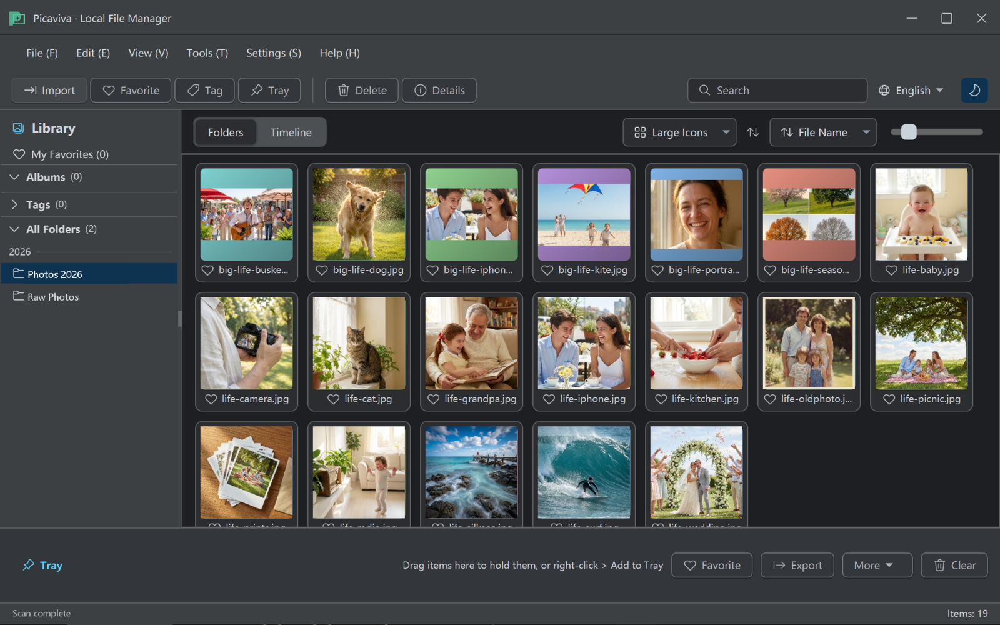

# Picaviva



Download packages for **Picaviva**, a Windows desktop app for local photos, videos and music.

## Download

Full-featured free edition — no registration required.

Latest build: [Releases](../../releases) · What's new: [changelog](https://picaviva.com/changelog.html)

Official page: [picaviva.com/download.html](https://picaviva.com/download.html)

Direct link pattern:

```
https://github.com/172986686/picaviva/releases/download/v1.0.8/Picaviva-1.0.8-win64.zip
```

SHA-256 checksums are published on the download page.

## System requirements

- Windows 10 (version 1607 or later) or Windows 11, 64-bit.
  Earlier Windows versions are not supported and the app will not start.
- Portable — unzip and run, no installation required

## License key

Picaviva Standard Edition is a one-time purchase covering two devices.

- Buy: [picaviva.com/buy.html](https://picaviva.com/buy.html)
- Lost your key: [picaviva.com/recover.html](https://picaviva.com/recover.html)

## License

Copyright © 2026 Picaviva. All rights reserved.

Distributed under the Picaviva terms of service:
[picaviva.com/terms.html](https://picaviva.com/terms.html)

## Support

Questions, bug reports and refund requests: 172986686@qq.com
